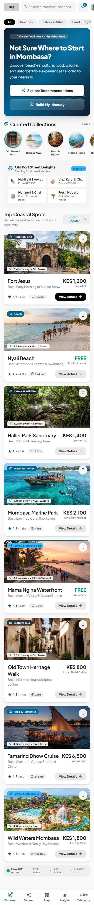

# CoastQuest Mombasa

A modern, responsive coastal tourism discovery web application for travelers exploring Mombasa, Kenya—built with **Node.js**, **Express.js**, and containerized for **Google Cloud Run**.



---

## How This App Was Built (4-Step Workflow)

### Step 1: UI/UX Design with Google Stitch

Designed the **CoastQuest Mombasa** interface using **[Google Stitch](https://stitch.withgoogle.com/)** with the following prompt:

```text
Act as an expert UI/UX designer, product designer, and frontend engineer. Design a modern, responsive tourism discovery web application called "CoastQuest Mombasa" for tourists visiting Mombasa who are overwhelmed by the many attractions, beaches, restaurants, cultural sites, and adventure activities available.

Problem Statement:
Many visitors arrive in Mombasa with limited time and too many options. CoastQuest Mombasa helps travelers quickly discover the best experiences based on their interests, budget, travel style, available time, and current location.

Target Users:
- Local tourists exploring Mombasa for the weekend
- International tourists visiting the Kenyan Coast
- Families looking for kid-friendly attractions
- Students and budget travelers
- Couples seeking romantic experiences
- Adventure seekers and nature lovers

Application Structure:

1. Header & Navigation
- CoastQuest Mombasa logo and branding
- Search bar with placeholder: "Search attractions, beaches, restaurants..."
- Interactive filter chips:
  - Beaches
  - Historical Sites
  - Food & Nightlife
  - Nature & Wildlife
  - Water Activities
  - Family Friendly
  - Hidden Gems
  - Free Activities
- User profile and saved destinations icon
- Responsive mobile hamburger menu

2. Hero Section
Headline:
"Not Sure Where to Start in Mombasa?"

Subheading:
"Discover beaches, culture, food, wildlife, and unforgettable experiences tailored to your interests."

Primary CTA:
"Explore Recommendations"

Secondary CTA:
"Build My Itinerary"

Background:
Beautiful panoramic imagery of Mombasa featuring beaches, palm trees, Fort Jesus, dhow boats, and ocean views.

3. Smart Travel Planner
Interactive recommendation wizard asking:
- How many days are you staying?
- What's your budget?
- Who are you traveling with?
- What interests you most?
- Preferred transport method?

Generate personalized recommendations instantly.

4. Featured Attractions Section
Responsive destination grid showcasing:
- Fort Jesus
- Nyali Beach
- Haller Park
- Mombasa Marine National Park
- Mama Ngina Waterfront
- Old Town
- Pirates Beach
- Wild Waters Theme Park
- Tamarind Dhow Experience
- Mtwapa Creek

Each attraction card should display:
- High-quality image
- Location
- Distance from current location
- Estimated cost (KES)
- Category badge
- Star rating
- Estimated visit duration
- Best visiting time
- Save/Favorite button
- "View Details" CTA

5. Interactive Attraction Detail Modal
When a card is selected, open a rich modal containing:
- Photo gallery
- Detailed description
- Opening hours
- Entry fees
- Travel tips
- Nearby attractions
- Restaurant recommendations
- Safety information
- Student discounts
- User reviews
- Weather preview
- "Get Directions" button
- "Add To Itinerary" button

6. Suggested Itineraries
Create visually appealing itinerary cards:
- Half-Day Explorer
- One-Day Mombasa Highlights
- Weekend Adventure
- Family Coastal Experience
- Romantic Escape
- Budget Backpacker Trail
- Luxury Coastal Retreat

Display:
- Activities included
- Duration
- Estimated transport cost
- Food budget
- Total estimated spend

7. Interactive Map Experience
- Embedded map of Mombasa
- Attraction markers
- Route suggestions
- Nearby attraction clustering
- Real-time filtering
- Distance calculations

8. Food & Nightlife Discovery
Featured locations:
- Swahili restaurants
- Seafood spots
- Rooftop lounges
- Beach clubs
- Local street food experiences

Each listing includes:
- Cuisine type
- Price range
- Popular dishes
- Ratings
- Directions

9. Travel Insights Dashboard
Beautiful analytics cards showing:
- Most popular attractions
- Average visitor ratings
- Top budget-friendly destinations
- Trending places this week
- Recommended experiences

10. Smart Recommendation Engine
Provide recommendations based on:
- Budget
- Travel duration
- Group type
- Interests
- Popularity score
- Distance

11. Grafana Faro Monitoring Demo
Include a dedicated observability section showcasing:
- Real User Monitoring (RUM)
- Frontend performance metrics
- User interaction tracking
- Page-load statistics

Actions:
- "Test Frontend Latency"
- "Generate User Activity"
- "Simulate Traffic"

These buttons trigger synthetic frontend events for Grafana Faro demonstrations.

12. Footer
- About CoastQuest Mombasa
- Tourism resources
- Emergency contacts
- Social media links
- Contact information
- "Powered by Grafana & Friends Kenya: Mombasa Dashboard Vol. 1"

Design System & Visual Style:

Color Palette:
- Deep Navy: #0F172A
- Ocean Blue: #0EA5E9
- Turquoise: #14B8A6
- Coral Accent: #FB7185
- Sand White: #F8FAFC

UI Style:
- Modern travel-tech startup aesthetic
- Glassmorphism-inspired cards
- Premium tourism platform feel
- Rounded corners (12–16px)
- Soft shadows and subtle depth
- High-quality photography
- Smooth hover states and animations
- Clean iconography
- Accessible contrast ratios

Typography:
- Bold, modern headlines
- Highly readable body text
- Professional travel-app appearance

Technical Requirements:
- Mobile-first design
- Fully responsive across phones, tablets, and desktops
- Fast-loading interface
- Accessibility compliant
- SEO-friendly structure
- Component-based architecture
- Optimized for Grafana Faro Real User Monitoring integration

The final UI should feel like a premium blend of Google Travel, Airbnb Experiences, and TripAdvisor, specifically tailored for discovering Mombasa's best experiences.
```

---

### Step 2: Production Conversion with Google AI Studio

Converted the CoastQuest Mombasa Stitch UI design into a production-ready, containerized Node.js/Express application using **[Google AI Studio](https://aistudio.google.com/)** with the following prompt:

```text
Take the CoastQuest Mombasa Stitch UI design and convert it into a production-ready, containerized Node.js/Express application optimized for deployment on Google Cloud Run.

Application Requirements

Backend
- Use Node.js with Express.js.
- Listen on process.env.PORT with a fallback to port 8080.
- Serve all frontend assets through Express.
- Include proper error handling and health-check endpoint (/health).
- Organize code using a clean project structure:
  /public
  /data
  /routes
  /server.js
  /Dockerfile

Frontend Functionality
- Preserve the original CoastQuest Mombasa design and responsiveness.
- Implement attraction search and category filtering.
- Load attraction data from a local JSON file instead of hardcoded HTML.
- Clicking "View Details" should open a dynamic modal populated from JSON data.
- Include realistic mock Mombasa attractions
```

---

### Step 3: Deployed on Google Cloud Run

The containerized Node.js/Express application is deployed on **Google Cloud Run**:

- **Live Cloud Run App:** [https://ais-pre-sqymuyrdnlrf2ob3nf5mfe-312090623596.europe-west2.run.app](https://ais-pre-sqymuyrdnlrf2ob3nf5mfe-312090623596.europe-west2.run.app)

---

### Step 4: Observability with Grafana Faro

Instrumented the application with **Grafana Faro** for Real User Monitoring (RUM), frontend Web Vitals, user interaction tracking, and error observability.

- **Grafana Faro Dashboard:** `[Add your Grafana Faro Dashboard link here](https://your-grafana-instance.grafana.net/d/your-dashboard-id)`

<!-- Replace the placeholder below with a screenshot of your Grafana Faro dashboard -->
> **Dashboard Preview:** *Add your Grafana Faro dashboard screenshot here (e.g., ``).*

---

## Project Structure

```text
.
├── data/
│   └── attractions.json      # Mombasa attractions dataset (rates, tips, coordinates, hours)
├── public/
│   ├── index.html            # Responsive CoastQuest Mombasa UI
│   ├── js/
│   │   └── app.js            # Search, category filtering, itinerary planner, map & modal logic
│   └── favicon.ico
├── routes/
│   ├── attractions.js        # GET /api/attractions & GET /api/attractions/:id
│   └── health.js             # GET /health Cloud Run health-check endpoint
├── server.js                 # Express server (process.env.PORT || 8080)
├── Dockerfile                # Multi-layer Node 22 Alpine container for Cloud Run
└── package.json
```

---

## Running Locally & With Docker

### Local Node.js

```bash
npm install
npm start
# App listens on http://localhost:8080 (or PORT env var)
```

### Containerized (Cloud Run Ready)

```bash
docker build -t coastquest-mombasa .
docker run -p 8080:8080 -e PORT=8080 coastquest-mombasa
```

### Key Endpoints

- `GET /` — CoastQuest Mombasa web application
- `GET /health` — Service health status, uptime, and timestamp
- `GET /api/attractions` — Filterable/sortable list of Mombasa attractions (`?search=`, `?category=`, `?sort=`)
- `GET /api/attractions/:id` — Detailed attraction record for the dynamic modal
